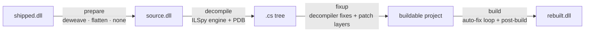
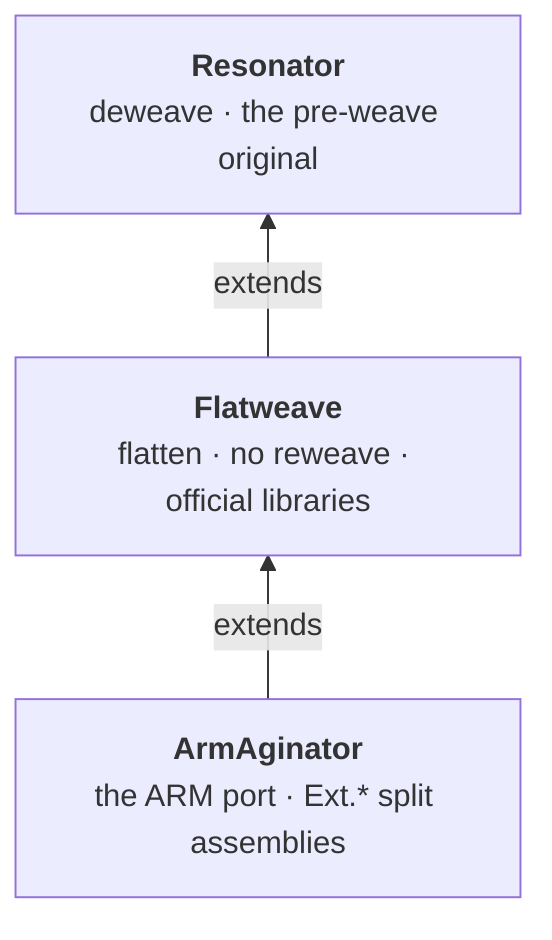

<div align="center">

# 🔊 Resonator

**Turns shipped Resonite assemblies into buildable C# source projects,
so the engine can be rebuilt, patched and ported (e.g. to Windows on ARM) from source.**

[](https://dotnet.microsoft.com/)
[](Directory.Build.props)
[](https://github.com/icsharpcode/ILSpy)
[](https://github.com/jbevain/cecil)
[](#requirements)
[](#-repo-hygiene)

[Getting started](docs/getting-started.md) ·
[Pipeline](docs/pipeline.md) ·
[Target sets](docs/target-sets.md) ·
[Patches](docs/patches.md) ·
[CLI reference](docs/cli.md) ·
[Shaders](docs/shaders.md)

</div>

---

## ✨ What it does



- **Exact weaver inverse.** `deweave` reverts every `FrooxEngine.Weaver` modification, proven by round trip:
  `weaver(deweave(shipped)) ≡ shipped`.
- **Or keep the weave as source.** `flatten` keeps the weaver's generated code, so the rebuilt engine is a
  drop-in for the shipped one and needs **no reweave**.
- **Layered target sets.** `Resonator → Flatweave → ArmAginator`: each set holds only its own patches on top
  of the one below.
- **Patches from edits.** Fix the generated project by hand, run `Resonator.PatchGenerator`, commit. Patches are
  located by context, so line drift is tolerated.
- **Official libraries.** Flatweave swaps the shipped native-wrapper forks for their official NuGet packages or
  pinned upstream sources.
- **Shaders.** `Resonator.ShadersReferenceBuilder` fetches every official shader with the game's own cloud client
  and emits a source tree plus a metadata table.

## 🚀 Quick start

```powershell
# 1. build the tools (needs the Resonite install, see below)
dotnet build Resonator.slnx -c Release

# 2. build the engine as a project from the shipped dlls
src\Resonator.ProjectBuilder\bin\Release\net10.0\Resonator.ProjectBuilder.exe out\engine --target FrooxEngine

# 3. edit out\engine, then turn the edits into patches of the set
src\Resonator.PatchGenerator\bin\Release\net10.0\Resonator.PatchGenerator.exe out\engine --target FrooxEngine
```

### Requirements

| | |
|---|---|
| .NET SDK | 10.0 |
| OS | Windows (Resonite install, PowerShell paths) |
| Resonite | `--resonite <dir>`, else `%RESONITE_DIR%`, else `C:\Program Files (x86)\Steam\steamapps\common\Resonite`. The solution build needs it too, for the shader tool (`RESONITE_DIR` or `-p:ResoniteDir=<dir>`). |

More in **[Getting started](docs/getting-started.md)**.

## 🧰 Tools

| Project | Kind | Purpose |
|---|---|---|
| [`Resonator.ProjectBuilder`](src/Resonator.ProjectBuilder) | CLI | shipped dll → buildable C# project |
| [`Resonator.PatchGenerator`](src/Resonator.PatchGenerator) | CLI | edited project → the target set's patches |
| [`Resonator.Deweaver`](src/Resonator.Deweaver) | CLI | deweave, `verify`, `known`, `syncmembers`, `reweave`, `diff`, `pdbcheck` |
| [`Resonator.ShadersReferenceBuilder`](src/Resonator.ShadersReferenceBuilder) | CLI | official shaders → reference source tree + metadata table |
| [`Resonator.Pipeline`](src/Resonator.Pipeline) | lib | target sets, prepare → decompile → fixup, patch application |
| [`Resonator.Weaver`](src/Resonator.Weaver) | lib | weaver knowledge: deweave, flatten, checks, reweave, Cecil helpers ([spec](src/Resonator.Weaver/README.md)) |

Every option is in the **[CLI reference](docs/cli.md)**.

## 🧱 Target sets



| Set | Prepare | Produces |
|---|---|---|
| `Resonator` | deweave / none | the pre-weave original, recompiled with only the patches needed to build. Covers every assembly the engine needs that is not plain managed code. |
| `Flatweave` | flatten | the shipped (weaved) engine as plain source, plus the official wrapper libraries. A drop-in for the shipped dll. |
| `ArmAginator` | flatten | the ARM port, consumed by the ArmAgedon repo ([README](targets/ArmAginator/README.md)). |

Specs, weave modes, the official-library table and the `target.json` keys are in **[Target sets](docs/target-sets.md)**.

## 📚 Documentation

| Doc | Contents |
|---|---|
| [Getting started](docs/getting-started.md) | requirements, building, first run, output layout, integration mode |
| [Pipeline](docs/pipeline.md) | the four stages, the automatic fixes, caching |
| [Target sets](docs/target-sets.md) | the set chain, what each covers, weave modes, official libraries, `target.json` |
| [Writing code for Flatweave](docs/flatweave.md) | the weaver's duties that fall to you on a non-reweaved engine |
| [Patches](docs/patches.md) | patch layers, the edit → generate loop, adding a target |
| [Shaders](docs/shaders.md) | the official shader reference tree and metadata table |
| [CLI reference](docs/cli.md) | every tool and option |
| [Weaver spec](src/Resonator.Weaver/README.md) | what the weaver does and what each deweave operation reverts |
| [Contributing](CONTRIBUTING.md) | conventions and the checks before a commit |

## 🗂️ Repository layout

```
Resonator.slnx               the solution
Directory.Build.props        shared settings (net10.0, nullable, ResoniteDir)
src/
  Resonator.ProjectBuilder/           CLI  shipped dll -> buildable C# project
  Resonator.PatchGenerator/           CLI  edited project -> the target set's patches
  Resonator.Deweaver/                 CLI  over Resonator.Weaver
  Resonator.ShadersReferenceBuilder/  CLI  official shaders -> reference tree + metadata
  Resonator.Pipeline/                 lib  target sets, stages, patch application
  Resonator.Weaver/                   lib  deweave, flatten, checks, reweave, Cecil helpers
targets/                     target sets: data only (set.json, target.json, patches/*.patch)
  Resonator/  Flatweave/  ArmAginator/
docs/                        the documentation above
```

## 🔒 Repo hygiene

> [!WARNING]
> Never commit decompiled sources or Resonite binaries. `.gitignore` covers build and output dirs
> and `*.dll` / `*.pdb` / `*.exe`. Patches carry decompiled context lines, so **keep the repo private**.
