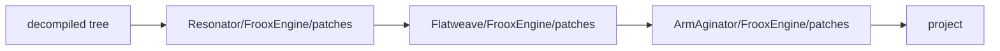
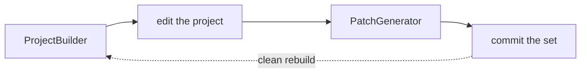

# Patches

[← README](../README.md)

## How patches apply

Every `*.patch` in a target's `patches/` is applied as a unified diff, with paths relative to the source root.
Hunks are located by context, so line drift is tolerated.

Layers are **cumulative**: the root ancestor's patches first, the target's own last.

Split targets (`select_types`) skip inherited patches for files outside their selection; these are reported as
`out-of-scope`.

## The edit → generate loop

1. Build the target: `Resonator.ProjectBuilder out\fe --set Flatweave --target FrooxEngine`
2. Edit the files in `out\fe\FrooxEngine` (Flatweave's FrooxEngine references source targets, which are built
   next to it - see [CLI](cli.md)) and get it to build.
3. Generate the patches: `Resonator.PatchGenerator out\fe --set Flatweave --target FrooxEngine`
   (same set and target selection as the build).
4. Commit `targets/<Set>/`.

`Resonator.PatchGenerator` compares the project with a fresh pipeline output and writes **only the target's own
layer**, as a delta over its ancestors' patches. It only ever writes into the set it runs on (`--set`):

- For an **inherited** target it creates `targets/<Set>/<Target>/` with a spec that `extends` the inherited one,
  plus the new patches, and only if there are any.
- To change something for the ARM port, run both tools with `--set ArmAginator`; the Resonator and Flatweave
  layers stay untouched. To change the base layer, use `--set Resonator`.

Hand-written files that are not in the decompilation belong in a keep dir (`Injected/`, see `keep_dirs`) or in
the consumer repo. The PatchGenerator reports them as injections.

> [!IMPORTANT]
> Running the PatchGenerator straight after a clean build must leave `git status` of the set clean.

## Adding a target

1. Create `targets/<Set>/<Target>/target.json`, usually `extends`-ing an existing target
   (keys: [`target.json`](target-sets.md#targetjson)).
2. Build it with `Resonator.ProjectBuilder`, fix what breaks in the output dir, run `Resonator.PatchGenerator`
   over it, and commit the patches.
3. Rebuild from scratch and run the PatchGenerator again: the set must stay clean.

## Patch or something else?

Patches carry decompiled source, so prefer fixes that avoid them (see [Pipeline → Where to fix what](pipeline.md#where-to-fix-what)):
an IL fix before decompilation, a decompiler fix for systematic artifacts, a patch only for local ones. The
[`Resonator/FrooxEngine` patches README](../targets/Resonator/FrooxEngine/patches/README.md) documents the base
layer patch by patch.
