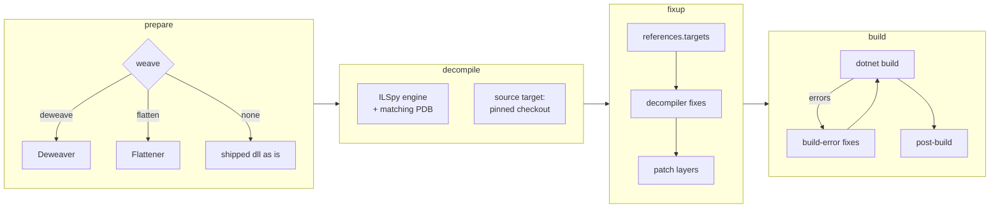

# Pipeline

[← README](../README.md)

`Resonator.ProjectBuilder` runs four stages per target. `--stage <s>` runs one of them only.

Source targets (official upstream code) run first, since dependents reference their projects. Package targets
skip every stage. A tree target (`"tree": true`: a source for the consumer's own build, native code included) is checked
out and patched, nothing more.

A full run generates each project in a staging copy first and then writes into the output only the files that changed
(see [CLI](cli.md#resonatorprojectbuilder)): a regeneration no longer makes every file look new to the consumer's build.

## 1. Prepare

Turns the shipped dll into the dll the decompiler reads, per the spec's `weave`:

| Mode | Does | Result |
|---|---|---|
| `deweave` (default) | reverts the `FrooxEngine.Weaver` modifications exactly | the pre-weave original; must be reweaved to run |
| `flatten` | keeps the weave, fixes only IL that C# cannot express | a drop-in for the shipped dll, no reweave |
| `none` | nothing | the shipped dll is decompiled as is |

Both weaver modes first check that the install's `FrooxEngine.Weaver.dll` is the known one, and refuse otherwise.
Prepared dlls are cached per shipped dll in `%TEMP%\resonator\deweaved` / `flattened`, so the split targets of one
assembly share one. Details: [Target sets → Weave modes](target-sets.md#weave-modes) and the
[weaver spec](../src/Resonator.Weaver/README.md).

## 2. Decompile

ICSharpCode.Decompiler (the ILSpy engine), in process. References resolve from the Resonite install. The PDB next
to the source dll is attached when it matches, which gives real local names (`--no-pdb` turns it off). One file
per type, in namespace folders. `select_types` / `exclude_types` narrow the tree.

A `source` target is checked out at its pinned ref instead (git or release archive).

## 3. Fixup

1. Writes `references.targets`.
2. Repairs mechanical decompiler artifacts in every file (`src/Resonator.Pipeline/Fixups/`):

   | Fix | Decompiled | Fixed |
   |---|---|---|
   | `OpenGenericCastFix` | `((ValueType<>)(object)this).Member` | `this.Member` |
   | `UnsafeAsFix` | `Unsafe.As<T>arg` | `Unsafe.As<T> (arg)` |
   | `NewTypeArgumentFix` | `new Typearg;` | `new Type(arg);` (known type names only) |
   | `GenericMemberCallFix` | `x.Name<T>arg` | `x.Name<T> (arg)` |

3. Applies the target's [patch layers](patches.md), root ancestor first.

Source targets get only step 1 and 3.

## 4. Build

Deploys the csproj template and compiles. A failing pass goes to the build-error fixes, and the build is retried
while they find something (up to 12 passes):

| Fix | Error | Action |
|---|---|---|
| `MissingReferenceFix` | CS0012, type in an unreferenced assembly | adds the install's dll to `references.targets` |
| `RefArgumentFix` | `ref` passed where the callee declares `in` | removes that `ref` |

Then the post-build steps:

- **FixCtor** (`fix_ctor_types`): strips the compiler's default `.ctor` from types where the weaver removed it
  (Fody marker types), so the rebuilt dll matches.
- **syncmembers** (every `flatten` build): checks the generated `GetSyncMember` code, see
  [Writing code for Flatweave](flatweave.md).
- **calli** (`calli` spec, CSCore): rewrites `[CSCalli]` stub calls into `calli` instructions, as upstream's
  CSCli does. Runs from `references.targets`, so it also runs in consumers' builds.

## Where to fix what

| Kind of problem | Fix it in |
|---|---|
| can be avoided before decompilation | the prepare stage (IL level) |
| systematic, many files | a decompiler fix in `Fixups/` |
| local to a file | a [patch](patches.md) |
| only the compiler can locate it | a build-error fix in `BuildFixes/` |
