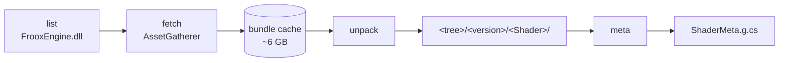

# Shaders

[← README](../README.md)

`Resonator.ShadersReferenceBuilder` is separate from ProjectBuilder: another input (cloud assets) and another
output. The shader sources are not shipped with the game, but every official shader version is a cloud asset
listed in the engine:

```
OfficialAssets.Shaders.<version>.<Shader>  ->  resdb:///<sha256>.unityshader
```

Version `_` is the current one; older ones are dated, like `_30_07_2023`.

## Usage

```powershell
Resonator.ShadersReferenceBuilder all --tree <dir>/Official --out <dir>/ShaderMeta.g.cs --namespace <ns> [--cache <dir>]
```



1. **fetch**: downloads the listed bundles with the game's own `SkyFrost.Base.AssetGatherer` (anonymous, HTTP
   only, user agent `Resonator`) into the cache as `<version>/<Shader>/<sha256>.unityshader`. Each file is
   verified against its SHA-256 and never downloaded twice. The full set is ~6 GB (compiled variants), so keep the
   cache somewhere permanent.
2. **unpack**: a bundle is a zip of `metadata.json`, `Sources/` (the ShaderLab source and its `.cginc` includes)
   and compiled `Variants/<platform>/`. `metadata.json` + `Sources/**` go to `<tree>/<version>/<Shader>/`. A cache
   dir with a hand-prepared `metadata.json` and no bundle is copied instead. Variants stay packed in the cache.
3. **meta**: writes `--out`, a partial `--class` (default `ShaderVariants`) in `--namespace` whose
   `AddGeneratedMeta(add)` lists, per shader version,
   `(version, shader, sourceFile.filename, sourceFile.hash, uniqueKeywords)` (bit *i* of a variant = keyword *i*).
   Works on any tree in that layout, hand-prepared ones included.

`list` prints what the installed engine lists. Each step also runs on its own (`fetch`, `unpack`, `meta`).

| Option | Default |
|---|---|
| `--resonite <dir>` | `%RESONITE_DIR%`, else the Steam path |
| `--cache <dir>` | `%RESONITE_SHADERS%`, else `%TEMP%\resonator\shaders` |
| `--tree <dir>` | required for `unpack`, `meta`, `all` |
| `--out <file>` | required for `meta`, `all` |
| `--namespace <ns>` | required for `meta`, `all` |
| `--class <name>` | `ShaderVariants` |
| `--parallel <n>` | `8` concurrent downloads |
