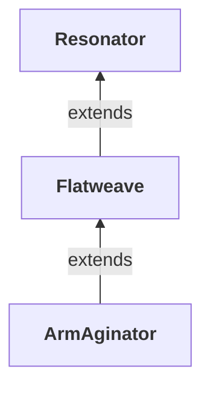

# Target sets

[← README](../README.md)

A **target** is one assembly to produce (`targets/<Set>/<Target>/target.json` + `patches/`). A **set** is a
directory of targets. The repo holds three, stacked:



Each set holds only its own layer. A set's `set.json` (`"extends": "<Set>"`) makes it inherit every target of the
set below. A target of its own replaces an inherited one, either by having the same name or by `extends`-ing it
(`ArmAginator/RenderiteShared` replaces `Resonator/Renderite.Shared`).

Within the chain, a target `extends` its counterpart below:

- `Flatweave/FrooxEngine` → `Resonator/FrooxEngine`
- `ArmAginator/FrooxEngine` and the `Ext.*` split targets → `Flatweave/FrooxEngine`
- `ArmAginator/Elements.Assets` → `Flatweave/Elements.Assets`

Patches apply base layer first.

| Set | Prepare | What it produces |
|---|---|---|
| `Resonator` | deweave / none | the pre-weave original, recompiled with only the patches needed to build. No behaviour change; needs the weaver to run like the shipped dll. |
| `Flatweave` | flatten | the shipped (weaved) engine as plain source: generated sync-member code, version stamp and marker kept, **no reweave needed**. Its native-wrapper libraries come from their [official releases](#official-libraries-flatweave); engine patches adapt to their APIs. |
| `ArmAginator` | flatten | the ARM port: `Ext.*` split assemblies, renderer-protocol changes, platform patches. Consumed by the ArmAgedon repo, see [`targets/ArmAginator/README.md`](../targets/ArmAginator/README.md). |

## What the `Resonator` set covers

Shipped native libraries (`assimp.dll`, `phonon.dll`, ...) come with managed wrappers (`AssimpNet.dll`,
`SteamAudio.NET.dll`, ...). To run on another architecture, a wrapper is swapped for one that matches its native
build. Then **every assembly that calls into a wrapper** has to rebuild against it. Starting from the engine's
run-time closure (`FrooxEngine.dll`, plus the weaved assemblies it loads), the set holds:

- **weaved** (`deweave`): `FrooxEngine`, `ProtoFluxBindings`, `ProtoFlux.Nodes.FrooxEngine`.
- **wrapper consumers** (`none`):

  | Assembly | Wrappers it calls |
  |---|---|
  | `Elements.Core` | Brotli.Core |
  | `Elements.Assets` | AssimpNet, Compressonator.NET, crunch.NET, FreeImageNET, Mikktspace.NET, Msdfgen.NET, PDFiumSharp, RNNoise.NET, SharpFont, SharpPipe |
  | `Awwdio` | SharpPipe, SteamAudio.NET |
  | `OpenLipSync.Inference` | Microsoft.ML.OnnxRuntime |
  | `Renderite.Shared` | YellowDogMan.Cloudtoid.Interprocess |

  The engine and the ProtoFlux assemblies are wrapper consumers too.
- **the wrappers themselves** (`none`): `ApplicationLoopback.NET`, `AssimpNet`, `Brotli.Core`,
  `Compressonator.NET`, `crunch.NET`, `FreeImageNET`, `LeapSharp`, `Microsoft.ML.OnnxRuntime`, `Mikktspace.NET`,
  `Msdfgen.NET`, `PDFiumSharp`, `POpusCodec`, `RNNoise.NET`, `SDL3-CS`, `SharpFont`, `SharpPipe`, `SoundFlow`,
  `SRAnipalSharp`, `SteamAudio.NET`, `Steamworks.NET`, `YellowDogMan.Cloudtoid.Interprocess`. Use these when no
  upstream replacement exists, or when a wrapper hard-codes its native name or bitness (`pdfium_x64`,
  `brolib_x64`; `Steamworks.NET` ships AMD64-only).

Left out: plain managed assemblies that touch no wrapper (they run unchanged on any architecture), and wrappers
over OS APIs only (`kernel32`, `user32`, `winmm`, `libc`, ...).

The targets build for net10.0, the runtime the game runs them on, not for their shipped netstandard / .NET
Framework TFMs. Those builds pulled in NuGet packages (System.Memory, ...) that `references.targets` does not model.
The exception is `FreeImageNET` (`net20`): its System.Drawing interop is not inbox on .NET 10.
`Resonator.Deweaver diff --api` against the shipped dll therefore differs only in attribute types the compiler
embeds per TFM (`EmbeddedAttribute`, `RefSafetyRulesAttribute`, `IsUnmanagedAttribute`, ...). The weaved ones
also differ in the Fody marker `.ctor`.

## Weave modes

`"weave"` in `target.json`:

- **`deweave`** (default): revert the FrooxEngine.Weaver modifications exactly, proven by round trip:
  `weaver(deweave(shipped)) ≡ shipped`. The rebuilt dll must be reweaved to run.
- **`flatten`**: keep the weave; fix only IL that C# cannot express (sync fields lose `readonly`, protected flips
  with inaccessible field types revert to private, `CoderAOT.Dummy` emptied). The engine reads `readonly` by
  reflection (`WorkerInitializer` picks sync members by it, `AssemblyTypeRegistry` builds the compatibility hash
  from it), so each cleared field gets `[Resonator.FlattenedInitOnly]` (defined in the flattened assembly) and the
  `Flatweave/FrooxEngine` patches make those checks read "readonly or marked". The compatibility hash of the
  rebuilt engine equals the shipped one, and the rebuilt dll is a drop-in for the shipped one. Every flatten build
  runs the `syncmembers` check; code you add must follow [the Flatweave rules](flatweave.md).
- **`none`**: not weaver-processed; decompile the shipped dll as is.

Both weaver modes first verify that the shipped `FrooxEngine.Weaver.dll` is the known one and refuse otherwise.

## Official libraries (Flatweave)

The `Resonator` set decompiles the wrappers the install ships, which are mostly Yellow Dog Man forks. `Flatweave`
replaces each with its official release, using one of two target kinds:

- **`package`**: the official NuGet package where one exists and fits. Nothing is built. Every dependent's
  `references.targets` gets a `PackageReference` instead of a HintPath to the install's dll.
- **`source`**: the official repository (or release archive) at a pinned commit, when there is no usable package.
  It is checked out instead of decompiled, then patched and synced like any target. Library patches are only for
  what the engine cannot reach from outside (CSCore's `WasapiOut` internals); everything else is an engine patch.

| Library (assembly) | Flatweave | Notes |
|---|---|---|
| SoundFlow, SteamAudio.NET, PDFiumSharp (`PDFiumSharpV2`), Brotli.Core (`Brotli.NET`), Steamworks.NET, SDL3-CS, Microsoft.ML.OnnxRuntime | package (official) | Steamworks.NET: engine patch cuts the fork-only `ExceptionHandler` hook |
| AssimpNet | package `AssimpNetter` 6.0.5 | the maintained continuation; official AssimpNet (2020) predates assimp 5.1's structs. Engine patch: System.Numerics types, matrix helpers (transpose-aware), bone node by name |
| Compressonator.NET, crunch.NET, Mikktspace.NET, Msdfgen.NET, SharpPipe | package `YellowDogMan.*` | Yellow Dog Man's own libraries: their published package is the official one |
| SharpFont | source Robmaister/SharpFont master | the NuGet package is net45-only |
| CSCore | source filoe/cscore master + patches | YDM's `WasapiOut`/`MMDevice` additions the WASAPI driver uses; `ILUtils` on `Unsafe`; session GUID by pointer; `calli` post-compile step. Engine patch: codec choice + OGG (NVorbis) in `CSCoreSampleDecoder` |
| FreeImageNET | source: the FreeImage 3.18.0 release's wrapper | engine patch: raw EXIF cleared directly |
| POpusCodec | source jasl8r/P-Opus, **Enums only** | the data-model enums `OpusStream` syncs; the codec is Concentus (managed, NuGet) behind adapters in `OpusStream.cs` |
| OpenLipSync.Inference | source KyuubiYoru/OpenLipSync | |
| RNNoise.NET, ApplicationLoopback.NET | source at YDM git HEAD | YDM's own, no package |
| LeapSharp, SRAnipalSharp, YellowDogMan.Cloudtoid.Interprocess, Renderite.Shared | decompiled (inherited) | not public / Resonite's own |

## `target.json`

| Key | Meaning |
|---|---|
| `name` | the target's name (used by `--target`) |
| `assembly` | the shipped dll (`FrooxEngine.dll`); not for a `tree` target |
| `extends` | `"<Set>/<Target>"`: inherit a target of another set |
| `weave` | `deweave` (default) \| `flatten` \| `none` |
| `select_types` | decompile only these types (split targets) |
| `exclude_types` | decompile everything except these |
| `exclude_refs` / `refs` | drop / add assembly references in `references.targets` |
| `package` | `{"id", "version"}`: a NuGet package target |
| `source` | `{"git" \| "archive", "ref", "dir", "exclude", "files", "submodules"}`: a source target; `ref` is a pinned tag or commit, `exclude` takes files or `dir/` prefixes, `files` the globs of what a checkout takes (default `["**/*.cs"]`; `**` any folders, `*` within a name), `submodules` the repo's submodules fetched with it (shallow, recursive) |
| `tree` | `true`: the source is a tree for the consumer's own build (native code, a repo's own projects), not a C# project of Resonator's: checked out and patched only - no `assembly`, `references.targets`, csproj or build. Patches can be on any text file |
| `packages` | `{"<id>": "<version>"}`: extra NuGet references of any target |
| `properties`, `defines` | MSBuild properties / extra `DefineConstants` in `references.targets` |
| `calli` | `{"attribute", "remove_type_attribute"}`: weave `[attribute]` stubs into `calli` right after compiling (CSCore) |
| `fix_ctor_types` | types whose compiler-generated default `.ctor` is stripped after the build |
| `weaver_check` | the weaver dll to verify (default `FrooxEngine.Weaver.dll`; `null` switches it off, except for `FrooxEngine.dll` itself, which is always checked) |
| `tfm`, `out_assembly`, `keep_dirs`, `description` | as named |

With `extends`, scalars override the parent; `exclude_types`, `exclude_refs`, `refs`, `fix_ctor_types`,
`keep_dirs` and `defines` accumulate; `select_types` replaces. A set's own target of the same name replaces an
inherited one entirely (that is how Flatweave's package/source targets replace the decompiled wrappers).

### Examples

A decompiled target layered on its base (`Flatweave/FrooxEngine`):

```json
{
  "name": "FrooxEngine",
  "extends": "Resonator/FrooxEngine",
  "weave": "flatten",
  "packages": { "Concentus": "2.2.2" }
}
```

A source target (`Flatweave/SharpFont`):

```json
{
  "name": "SharpFont",
  "assembly": "SharpFont.dll",
  "source": {
    "git": "https://github.com/Robmaister/SharpFont",
    "ref": "26454a8b5b53733ff7a10de2322469b64cb75ee8",
    "dir": "Source/SharpFont",
    "exclude": [ "Properties/" ]
  }
}
```

A tree target (`ArmAginator/MonoGame`, abridged): the repo with the submodules the consumer's CMake and MSBuild builds
need, every file but the excluded folders. Its patches are per file like any other (`MGG_Vulkan.cpp.patch`):

```json
{
  "name": "MonoGame",
  "tree": true,
  "source": {
    "git": "https://github.com/MonoGame/MonoGame",
    "ref": "5e9fe9b100ffa67026dff97cc8adffae1414534e",
    "dir": "",
    "files": ["**"],
    "exclude": ["Tests/", "Templates/", "external/MonoGame.Templates/"],
    "submodules": ["native/monogame/external/sdl2", "external/stb"]
  }
}
```

A package target (`Flatweave/SoundFlow`):

```json
{
  "name": "SoundFlow",
  "assembly": "SoundFlow.dll",
  "package": { "id": "SoundFlow", "version": "1.4.1" }
}
```
